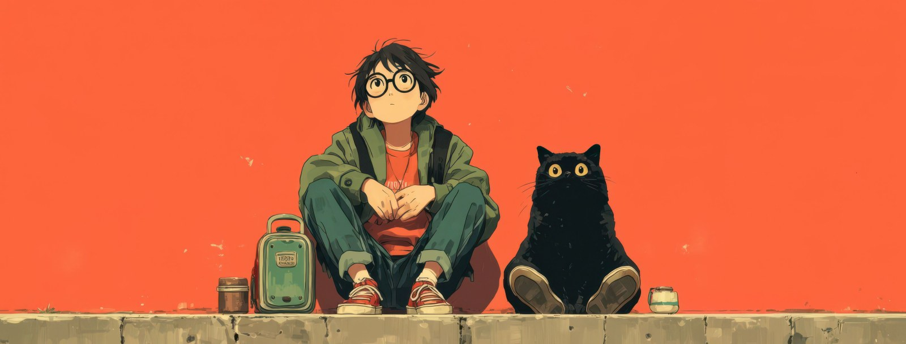

<!-- Palette from the banner: orange #FC643B · cat black #0F191B · jacket green #486551 · eye yellow #F2C14E · cream #F3E9D2 · ledge #A7966B -->

<!-- Header -->

  

<h2 align="center">สวัสดีครับ 🙏 I'm Sakda Baokham</h2>

  

  
  

## 🐈‍⬛ About Me

- 🎓 Studying **Computer Engineering** at **RMUTT** (Rajamangala University of Technology Thanyaburi)
- 🤖 Building **RAG** pipelines and **Agentic AI** systems: chunking, embeddings, FAISS, hybrid retrieval, LLM answers
- ⚙️ Backend owner on team projects: **FastAPI** gateway, auth, Docker Compose, and integrating every module
- 👁️ Doing **Computer Vision** with OpenCV, MediaPipe and YuNet ([Auto Face Blur](https://github.com/sakda1306/auto-face-blur-project))
- 📱 Started out with **Kotlin** Android apps, and also tried **Laravel** e-commerce
- 🧭 Team coordinator: contracts, git flow and schedules so 4–7 people can merge without pain
- ⚡ Fun fact: my RAG playground is a football trivia dataset with 1,996 Q&A ⚽

 

## 🛠️ Languages & Tools

   
  

## 💻 Tech Stack

  
  
  
  
  
  
  
  
  
  
  
  
  
  
  
  
  

## 🚀 Featured Projects

  
  
  
  

| Project | What I did | Stack |
|---|---|---|
| 🙈 [**Auto Face Blur**](https://github.com/sakda1306/auto-face-blur-project) | Multi-face detection (MediaPipe + YuNet) with Gaussian blur / mosaic for PDPA privacy, Streamlit web app | Python · OpenCV · MediaPipe · Streamlit |
| ⚽ [**Football Assistant (Team D-II)**](https://github.com/sakda1306/Advanced-Topic-in-Computer-Software-Course-Team-D-II) | Agentic AI for Premier League: cited answers, fixtures, tables, weekly reports. I own the API backend and retrieval | FastAPI · RAG · Docker Compose |
| 🧳 [**Travel Safety Assistant (Team D)**](https://github.com/sakda1306/Advanced-Topic-in-Computer-Software-Course-Team-D) | AI-powered real-time travel safety advisor. I own the API gateway, auth and module integration | FastAPI · PostgreSQL · Redis · Docker |
| 📚 [**Advanced Topics in Computer Software**](https://github.com/sakda1306/04622404-Advanced-Topics-in-Computer-Software) | RAG from scratch: chunking, embeddings, FAISS vector DB, hybrid retrieval, memory, evaluation | Python · FAISS · LLM |
| 🛒 [**Bagisto Dev**](https://github.com/sakda1306/Bagisto_Dev) | Laravel e-commerce platform development | PHP · Laravel · Docker |
| 📱 [**Programmer Trainee**](https://github.com/sakda1306/Programmer_Trainee) · [**Record App**](https://github.com/sakda1306/Record-Application) | Android apps | Kotlin · Gradle |

## 🔥 GitHub Stats

  
  

  
  

## 🤝 Connect With Me

  
  

<!-- Footer -->

  

